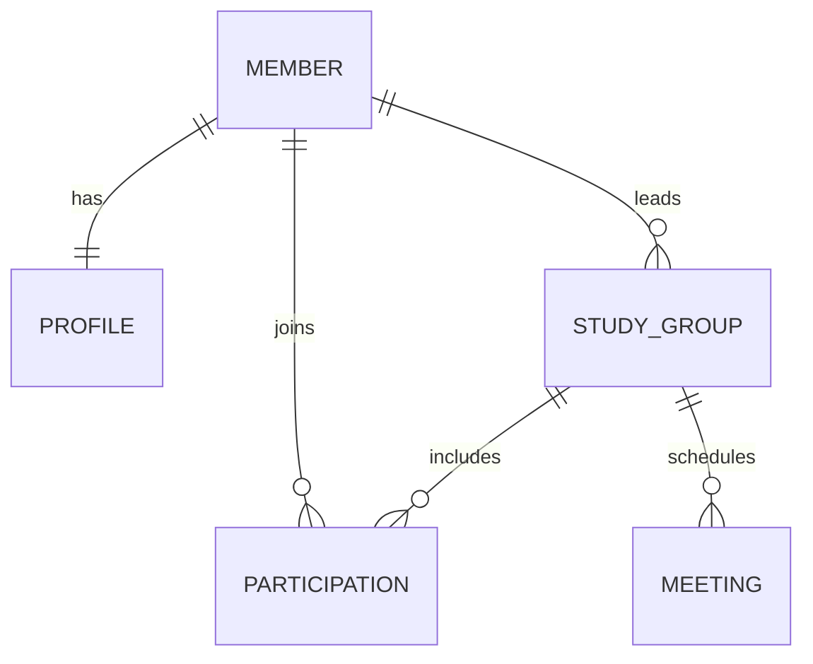

# 스터디 모집·모임 관리 서비스

Java 21과 MySQL이 필요합니다. 기존 Docker MySQL 컨테이너에 `study_manage` 데이터베이스를 생성합니다. PowerShell에서 컨테이너 이름을 확인하고 MySQL에 접속합니다.

```powershell
docker ps --format '{{.Names}} {{.Ports}}'
$mysqlContainer = Read-Host 'MySQL 컨테이너 이름'
docker exec -it $mysqlContainer mysql -u root -p
```

MySQL에서 아래 SQL을 실행합니다. `CHOOSE_A_PASSWORD`는 앱 계정에 사용할 비밀번호로 바꿉니다.

```sql
CREATE DATABASE IF NOT EXISTS study_manage CHARACTER SET utf8mb4 COLLATE utf8mb4_unicode_ci;
CREATE USER IF NOT EXISTS 'study_manage'@'%' IDENTIFIED BY 'CHOOSE_A_PASSWORD';
GRANT ALL PRIVILEGES ON study_manage.* TO 'study_manage'@'%';
EXIT;
```

저장소 루트에서 실행합니다. Docker가 MySQL의 호스트 포트를 3306과 다르게 매핑했다면 `DB_PORT`를 지정합니다. `DB_HOST`와 `DB_USER`의 기본값은 각각 `localhost`와 `study_manage`입니다.

```powershell
cd study-manage
$env:DB_PASSWORD = Read-Host 'MySQL 앱 계정 비밀번호' -MaskInput
.\gradlew.bat bootRun
```

애플리케이션의 기본 주소는 `http://localhost:8080`입니다. IntelliJ에서 실행할 때는 실행 구성의 환경 변수에 `DB_PASSWORD`를 설정합니다. Gradle 테스트는 별도의 메모리 H2 DB를 사용합니다.

## PR 제출용 설명

스터디 모집과 모임 일정을 관리하는 REST API를 추가했습니다. 데이터는 Spring Data JPA로 저장합니다.

### 구현 기능

| 기능 | 메서드와 경로 | 요청 JSON 필드 |
| --- | --- | --- |
| 회원 등록 | POST /api/members | name, bio |
| 회원·프로필 조회 | GET /api/members/{memberId} | |
| 회원·프로필 수정 | PUT /api/members/{memberId} | name, bio |
| 스터디 개설 | POST /api/studies | leaderId, title, description, capacity |
| 스터디 목록 | GET /api/studies | |
| 스터디 상세 | GET /api/studies/{studyId} | |
| 참여 | POST /api/studies/{studyId}/participants | memberId |
| 참여 목록 | GET /api/studies/{studyId}/participants | |
| 탈퇴 | DELETE /api/studies/{studyId}/participants/{memberId} | |
| 일정 등록 | POST /api/studies/{studyId}/meetings | memberId, title, location, startsAt |
| 일정 목록 | GET /api/studies/{studyId}/meetings | |

`startsAt`은 시간대가 포함된 ISO 8601 날짜·시간입니다. 일정 목록은 시작 시각 순서로 정렬합니다. 로그인 없이 요청의 회원 ID를 사용합니다.

### Entity 관계



- 프로필은 고유한 `member_id` FK를 소유합니다. 회원 정보와 자기소개를 분리하면서 회원당 프로필 하나를 보장합니다.
- 여러 회원이 여러 스터디에 참여합니다. `Participation`이 `study_id`, `member_id`, `joinedAt`을 저장하며 두 FK의 조합에 고유 제약을 둡니다.
- 스터디는 `leader_id`를, 일정은 `study_id`를 소유합니다. FK를 가진 엔티티에서 단방향으로 참조하고, 참여·일정 목록은 스터디 ID로 조회합니다.

### 서비스 규칙과 트랜잭션

- 회원과 프로필은 한 트랜잭션에서 생성·수정합니다. 스터디 개설과 스터디장 자동 참여도 같은 트랜잭션에서 처리합니다.
- 스터디장은 정원에 포함되고 탈퇴할 수 없습니다. 일반 회원은 탈퇴하면 정원이 비고 다시 참여할 수 있습니다. 다시 참여하면 새 참여 시각을 기록합니다.
- 참여와 탈퇴는 같은 스터디 행에 쓰기 잠금을 획득합니다. 중복·정원 확인과 저장을 같은 트랜잭션에서 실행해 동시 요청도 정원을 지키도록 했습니다.
- 스터디장만 미래의 모임 일정을 등록할 수 있습니다.
- 잘못된 입력은 400, 일정 등록 권한이 없으면 403, 리소스가 없으면 404, 중복 참여·정원 초과·스터디장 탈퇴는 409를 반환합니다.
